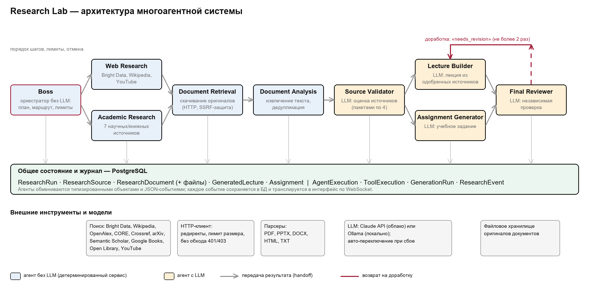

# Research Lab

**A multi-agent system that finds, reads and vets teaching material, then drafts a lecture and an
assignment from it.**

A teacher enters a topic. Nine agents search ten open sources (OpenAlex, CORE, Semantic Scholar,
Crossref, arXiv, Google Books, Open Library, Wikipedia, YouTube, Bright Data), download the openly
available documents, extract their text, score every source, write a lecture and an assignment from
the approved sources only, and have an independent agent review the result. Every agent step, tool
call and model call is logged and shown live in the browser.



```
 BOSS (script: plan, order, limits, cancel)
   ├──► WEB RESEARCH ────────┐   Bright Data · Wikipedia · YouTube
   └──► ACADEMIC RESEARCH ───┤   OpenAlex · CORE · Semantic Scholar · Crossref · arXiv · Google Books · Open Library
                             ▼
                     DOCUMENT RETRIEVAL      dedup by metadata → download originals (SSRF-safe)
                             ▼
                     DOCUMENT ANALYSIS       extract text (PDF/PPTX/DOCX/HTML/TXT) → dedup by content
                             ▼
                     SOURCE VALIDATOR (LLM)  scores → accept / review / reject
                             ▼
              LECTURE BUILDER (LLM) · ASSIGNMENT GENERATOR (LLM)
                             ▼
                     FINAL REVIEWER (LLM)    needs revision → back to the author (≤ 2×)
```

## Stack

| | |
|---|---|
| Backend | Django 5.2, Django REST Framework, Channels (WebSocket), JWT auth, SQLite |
| Frontend | React 19, TypeScript, Vite, Tailwind CSS, TanStack Query, React Flow |
| LLMs | Anthropic (Claude), OpenAI, or any local OpenAI-compatible server (Ollama, vLLM, LM Studio) |

No Docker, Redis, Celery or PostgreSQL: a run executes in a background thread of the Django process
and live events go through Channels' in-memory layer.

## Quick start

Requirements: Python 3.12+, Node.js 20+.

### 1. Backend

```bash
cd backend
python3 -m venv .venv
source .venv/bin/activate            # Windows: .venv\Scripts\activate
pip install -r requirements.txt

cp .env.example .env                 # then add your keys (see below)
python manage.py migrate
python manage.py seed_defaults       # LLM providers, model configurations, agent prompts
python manage.py createsuperuser     # an ADMIN account
python manage.py runserver           # http://localhost:8000  (API docs: /api/docs/)
```

### 2. Frontend

```bash
cd frontend
npm install
npm run dev                          # http://localhost:5173
```

Open http://localhost:5173 and sign in. The Vite dev server proxies `/api` and `/ws` to the backend.

### 3. Keys

Put them in `backend/.env` (never committed). You need **at least one LLM** to generate lectures
and assignments; the "materials search" mode (find, download and read) works without any.

| Variable | Needed for |
|---|---|
| `ANTHROPIC_API_KEY` / `OPENAI_API_KEY` | cloud models |
| `LOCAL_LLM_BASE_URL` | a local model server, e.g. Ollama at `http://localhost:11434/v1` |
| `BRIGHTDATA_API_TOKEN` + `BRIGHTDATA_SERP_ZONE` | web search |
| `CORE_API_KEY`, `YOUTUBE_API_KEY` | CORE, YouTube |
| `OPENALEX_API_KEY`, `SEMANTIC_SCHOLAR_API_KEY`, `GOOGLE_BOOKS_API_KEY`, `API_CONTACT_EMAIL` | optional, higher rate limits |

Model choice, the default LLM mode (Local / Cloud / Hybrid) and which sources are switched on are
set in the app under **Settings → Research Lab** (admin) or in the Django admin at `/admin/`.

## Roles

* **ADMIN** (`createsuperuser`) — sees every run, edits module settings and models.
* **TEACHER** — what self-registration creates; creates and sees their own runs.

## Tests

```bash
cd backend && python manage.py test      # 177 tests, external services replaced by fakes
cd frontend && npm run build             # type-check + production build
```

## Documentation

* [`docs/ARCHITECTURE.md`](docs/ARCHITECTURE.md) — agents, providers, fault tolerance, data model, API
* `docs/Research_Lab_report.docx` — design report: why a team of agents, decisions, test scenarios
* `docs/run-18-report.md`, `docs/run-19-report.md` — load reports of two reference runs
